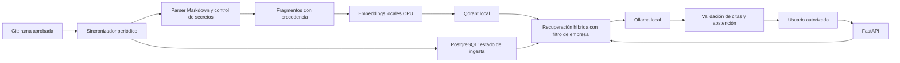

# Arquitectura inicial y plan de Fase 1

## Viabilidad y decisiones

Hardware observado el 27 de octubre de 2026: Intel i9-13900HX, 64 GB RAM,
RTX 4060 Laptop de 8188 MiB VRAM y aproximadamente 263 GB libres en C:.
Es viable experimentar con inferencia local. Recomendación inicial: Qwen3 4B
cuantizado Q4 con Ollama, contexto inicial de 4096 tokens y una solicitud a la vez.
Es una estimación de capacidad, no una medición de rendimiento. Verificar memoria
y latencia reales antes de aumentar contexto o concurrencia.

Embeddings: multilingual-e5-small con Sentence Transformers en CPU para reservar
VRAM al LLM; usar prefijos `query:` y `passage:`. Pesos precargados y carga desde
ruta local, sin descargas implícitas en ejecución. Reranker queda aplazado hasta
tener evidencia de que mejora las evaluaciones.

Python 3.12 es la base recomendada del RAG; 3.13 permite ejecutar la primera entrega
con el entorno disponible. Antes de instalar PyTorch/Sentence Transformers se debe
validar el conjunto exacto de ruedas para Windows y congelarlo por separado.
FastAPI/Pydantic simplifican contratos y validación; subprocess Git evita otra
dependencia y permite comandos explícitos sin shell. Qdrant aportará vectores locales.
SQLAlchemy/PostgreSQL guardarán estado transaccional al incorporar indexación.
No se necesitan todavía para leer un snapshot, evitando instalar servicios sin uso.
La interfaz y el catálogo corresponden a la Fase 2.



El diagrama describe el destino de la Fase 1, no funcionalidades ya implementadas.
Primera entrega: `FastAPI -> lector Git -> snapshot Markdown`.
Segunda entrega implementada: `snapshot -> fragmentación -> índice incremental SQLAlchemy/SQLite`.
SQLite permite validar localmente sin servidor; PostgreSQL se mantiene como destino
empresarial y requiere una implementación y migración posteriores.
Detalles actuales: [ingesta incremental](ingestion.md).
Tercera entrega: [embeddings y búsqueda semántica local](semantic-search.md).

## Estructura

```text
src/support_ai/
  main.py              # fábrica de API y configuración local
  git_reader.py        # documentos y snapshot inmutable
  chunking.py          # fragmentos Markdown con líneas y bloques de código
  storage.py           # esquema SQLAlchemy y conexión SQLite local
  ingestion.py         # sincronización incremental transaccional
tests/test_api.py      # integración con Git real temporal
examples/knowledge/    # tres documentos ficticios
docs/                  # decisiones y licencias
pyproject.toml
requirements-lock.txt
```

Al implementar RAG se agregarán módulos `ingestion`, `retrieval`, `providers` y
`storage`, junto a migraciones y Compose. No crear abstracciones vacías antes de usarlas.

## Modelo mínimo

Implementado en Pydantic: Snapshot(commit, documents), Document(path, commit,
sha256, content). Se fija primero un commit y se leen sus objetos; no el working tree.

Modelo persistente previsto:

| Entidad | Campos mínimos |
| --- | --- |
| Empresa | id, nombre |
| Repositorio | id, empresa_id, origen autorizado, rama, commit_indexado |
| Documento | id, empresa_id, repositorio_id, ruta, blob_hash, commit |
| Fragmento | id, empresa_id, documento_id, ordinal, texto, líneas, modelo_embedding |
| EjecuciónIngesta | id, repositorio_id, commit_objetivo, estado, error, fecha |

Unicidad por repositorio/ruta y documento/ordinal/versión de embedding.
El payload vectorial incluirá empresa, repositorio, ruta, commit y líneas.
La empresa se obtendrá de identidad autenticada; no confiar en un tenant enviado
por el cliente. Hasta introducir identidad, el MVP es monousuario y exclusivamente local.

## Ingesta e incrementalidad previstas

Sincronizar solo ramas configuradas mediante un proceso periódico; webhooks después.
No considerar un commit aprobado solo por existir: inicialmente el responsable
debe conectar una rama protegida con revisión en el proveedor Git.
Comparar manifiesto por hashes para altas, cambios y bajas; reutilizar embeddings
sin cambios. Publicar una generación completa del índice antes de avanzar
commit_indexado, y conservar la anterior si falla. No mezclar citas de generaciones.
Renombrar se puede tratar como baja y alta. Nunca ejecutar contenido ni hooks Git.
Clonado remoto y políticas de credenciales/orígenes se implementarán posteriormente.

## Endpoints

| Estado | Método/ruta | Propósito |
| --- | --- | --- |
| Implementado | GET /health/live | Proceso disponible; no afirma disponibilidad de IA |
| Implementado | GET /api/v1/knowledge/snapshot | Markdown y procedencia del repo configurado |
| Implementado | POST /api/v1/knowledge/sync | Indexar el repo local configurado de forma síncrona |
| Implementado | GET /api/v1/knowledge/status | Estado persistente del índice local |
| Implementado | GET /api/v1/knowledge/chunks | Fragmentos paginados con ruta, commit y líneas |
| Implementado | POST /api/v1/knowledge/vectorize | Preparar embeddings y generación Qdrant local |
| Implementado | GET /api/v1/knowledge/vectors/status | Commit de vectores y desfase con fragmentos |
| Implementado | POST /api/v1/search | Buscar fragmentos mediante embeddings locales |
| Previsto | GET /health/ready | Verificar servicios/modelos realmente disponibles |
| Previsto | POST /api/v1/repositories | Registrar origen y rama permitidos |
| Previsto | POST /api/v1/repositories/{id}/sync | Solicitar ingesta y obtener job_id |
| Previsto | GET /api/v1/repositories/{id}/status | Commit indexado, estado y error |
| Implementado | POST /api/v1/chat | Respuesta extractiva local, abstención y fuentes |

Chat devolverá fuentes con ruta, commit, fragmento y líneas. La búsqueda híbrida
combinará similitud vectorial con términos exactos/endpoints. Se abstendrá sin
evidencia suficiente; validar citas no garantiza por sí solo ausencia de alucinaciones.
Documentos recuperados serán datos no confiables, no instrucciones del sistema.
No habrá herramientas de ejecución de comandos en el chat.

## Aceptación del MVP completo (pendiente)

1. Ingestar los tres documentos ficticios y consultar sin Internet.
2. Preguntar por ms-orders: citar su responsabilidad y dependencia de ms-auth.
3. Preguntar por el error 504: citar el documento de pagos y sus 10 segundos.
4. Pedir el cURL de órdenes: reproducir únicamente el comando documentado.
5. Preguntar por un endpoint o servidor SFTP inexistente: reconocer falta de datos.
6. Confirmar una modificación, alta y baja: actualizar solo documentos afectados;
   una sincronización sin cambios no recalcula embeddings.
7. Tras fallo de ingesta, continuar sirviendo la última generación completa.
8. Todas las citas resuelven a archivos y commits existentes del índice activo.
9. No ejecutar instrucciones incrustadas en documentos ni acceder a producción.
10. Medir recuperación y respuestas sobre preguntas esperadas, desconocidas y
    documentos con prompt injection; registrar fallos y latencia, sin inventar métricas.

Fragmentación, persistencia, búsqueda híbrida y chat local extractivo ya están implementados.
Consulta [el chat y su evaluación](chat.md). Esperar confirmación antes de ampliar
el alcance o avanzar a Fases 2–4.
