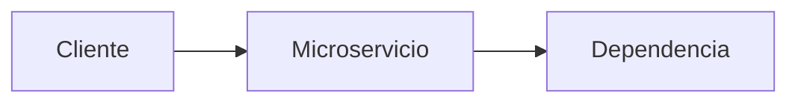

# <Nombre del microservicio>

## Qué es y para qué sirve

<Responsabilidad, usuarios y necesidad que resuelve. Indicar qué está verificado.>

## Arquitectura y dependencias

<Sistemas de entrada, servicios dependientes, base de datos y sistemas de salida.>

<Sustituir el diagrama de plantilla por la arquitectura real y validada.>

## API y ejemplos

<Documentar método, ruta, propósito, autenticación, parámetros y respuesta.
Agregar únicamente ejemplos verificados; usar marcadores para credenciales.
Si algo no se conoce, escribir explícitamente que no está documentado.>

## Errores conocidos

| Código o síntoma | Causa confirmada | Diagnóstico de solo lectura | Solución revisada |
| --- | --- | --- | --- |
| <error> | <causa> | <pasos verificados> | <solución y aprobación necesaria> |

## Procedimientos de soporte

<Requisitos, pasos, resultados esperados y cuándo escalar.
Identificar explícitamente operaciones que requieren autorización.>

## Logs y observabilidad

<Dónde consultar logs, correlación, métricas y alertas. No incluir datos sensibles.>

## Referencias y pendientes

<Documentos relacionados, decisiones y datos aún no confirmados.>
